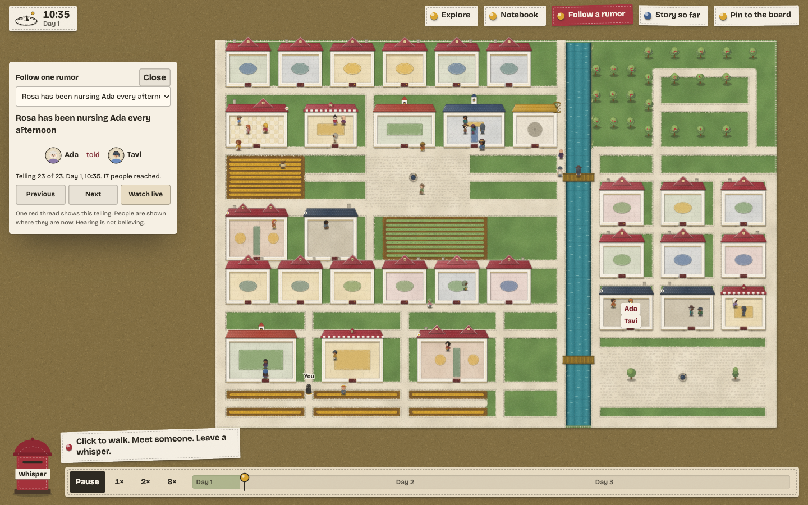

# RumorTown

RumorTown is a browser game about a village of 36 fictional adults, where a whispered lie can spread, divide friends and leave a grudge. Its villagers use a deterministic simulation built on research-informed rules, while the reusable `rumormind` library tracks beliefs, remembered sources and relationships.

Whisper to Mira that Tom stole bread, open “Follow a rumor”, and watch the story meet the people who know what happened. Tap a villager to inspect their beliefs, remembered sources and reasons. Open “Explore” to travel through four neighbourhoods, cross the river at either bridge and watch conversations around the village. Eastbank brings pottery, boat repairs and a market; the south commons adds a reading room, posthouse, teahouse and community gardens. Woodland paths connect quiet clearings beyond the orchard. Hold WASD or an arrow key to walk. Each villager has a private worry, an ambition and social motives. Rewind the timeline or share the run with a link.

Under “More”, the “Notebook” exports synthetic observations as JSON/CSV and compares three-day runs across one or five seeds with an assumption removed. See the [research model, evidence and limitations](docs/research-model.md).

Built by [Madhav Sunil](https://github.com/Maddy824).



## Run locally

From the repository root:

```sh
npm install
npm run dev
npm test
npm run build
npm run bench
```

Open the local address printed by Vite. `npm test` runs the test suite; `npm run build` creates the browser build. Both player-written whispers and the ready-made rumor menu work locally. Write up to 100 characters, choose the subject, story category and weight, then follow its tellings one at a time. The original words stay in replay links and research exports.

The default game runs the real village simulation. `?fake=1` opens the UI fixture; `?renderer=stub` selects the plain development renderer. No account or API key is needed to play or write your own stories.

## For developers

Open **More → For developers** in the game for a free local agent tour, or run `npm run agent:demo` from this checkout. The headless adapter exposes observe, move, approach, whisper and wait tools, with bounded actions and exact replay. `npm run --silent agent:serve` accepts JSON tool calls from your controller. See the [agent guide](docs/agents.md). The supplied planner runs locally and uses **$0 AI credits**.

Optional AI interpretation is disabled by default. A $0.019 daily allowance paces the $7 lifetime live budget across a year; a separate $2 development key leaves $1 headroom from a $10 prepaid balance. Phone alerts must be connected before external model requests can run. See [credit controls and phone setup](docs/credit-controls.md).

## Repository map

| Directory | Purpose |
|---|---|
| [packages/rumormind](packages/rumormind/README.md) | Dependency-free TypeScript for belief, provenance, trust, gossip, mood and repair. |
| [apps/rumortown](apps/rumortown) | Vite browser game, simulation, authored content, canvas rendering and controls. |
| [apps/api](apps/api) | Cloudflare Worker for optional typed-rumor interpretation, signing and a durable budget ledger. |

See [the architecture](docs/architecture.md) for module boundaries, replay and the request path.

The game runs each village in the browser and deploys as CDN-served static assets. The optional AI service has separate traffic admission and spending limits. See [capacity assumptions and load checks](docs/scale.md); million-user capacity still needs production validation.

## How the villagers think

These eight rules describe the main belief and gossip mechanisms. “Measured direction” means the research supports the pattern; the numerical translation remains a modelling choice. This is not a validated psychological predictor. Defaults come from [the library tuning](packages/rumormind/src/tuning.ts); the evidence tags follow [the design's evidence table](docs/superpowers/specs/2026-10-21-rumortown-design.md#8-simulation-rules-and-defaults).

| Rule in plain words | Default and evidence tag |
|---|---|
| A trusted teller is more persuasive. | Hearsay weight `1.0`, scaled by trust and expressed confidence. At trust `0.6` and full strength, a neutral belief moves from `0.5` to about `0.65`. Measured direction; tuned weight. Bailey et al. 2023. |
| Seeing something counts more than hearing it. | First-hand weight `2.5`, scaled by clarity. Measured direction; tuned multiplier. Weizsäcker 2010. |
| Repetition makes a story feel familiar. | The familiarity bonus is `0.45 * (n - 1)^0.25` log-odds, capped at `1.0`, with none on the first hearing. Measured effect and dose-response shape; tuned scale and cap. Ye et al. 2026; Hassan and Barber 2021. |
| Two tellers may still be one source. | Remembering their shared origin halves the new evidence; forgotten origins can look independent. Measured direction; tuned factor `0.5`. Weaver 2007; Yousif 2019. |
| Affection changes the starting assumption. | On first hearing, affinity shifts the prior by up to `0.6` log-odds: liking someone dampens harmful claims about them. Tuned extrapolation. Pfänder and Altay 2025. |
| Corrections help but leave a trace. | At full credibility, an alternative explanation removes `60%` of positive log-odds, a bare denial `40%`; a floor of `20%` of the peak remains. Corrections never raise the original belief. Measured direction; tuned fractions. Walter and Murphy 2018; Ecker 2022. |
| Bad news is more likely to be passed on. | Negative content gets sharing odds of `1.5`, represented by a `ln(1.5)` score bonus. Confidence, closeness and whether the listener already knows also affect telling. Measured sharing effect; tuned score mapping. Acerbi 2022; Dores Cruz et al. 2021. |
| Trust falls faster than it recovers. | Negative trust adjustments count twice; exposure can impose a lasting ceiling of `0.75` of full trust. Measured direction; tuned multiplier and ceiling. Schweitzer 2006. |

Dialogue is authored and selected by rules. Player-written text uses the subject, category and weight you select; the game does not infer its meaning. The optional interpretation Worker remains a separate service and is not called by the current writing form. Inspection exposes remembered sources, moods and reasons for decisions.

## Stay within a $10 AI budget

The intended deployment uses four layers. The account and hosting settings must be configured by the operator; repository code cannot establish those settings by itself.

1. Prepaid credit: load $10 on OpenRouter and leave automatic top-up off. Exhausted credit stops interpretation; the ready-made menu remains available.
2. Capped keys: cap the live key at $7 and the development key at $2, leaving $1 unallocated. These are provider-side stops outside the application.
3. The ledger: one SQLite Durable Object reserves the worst-case cost before any model call, then settles usage. Its defaults are $0.019 per UTC day, $7 for the lifetime of the ledger, 20 calls per minute globally and 5 per hour per hashed visitor bucket. Phone notification acceptance is required before model dispatch, and paid inference is off by default. Cache hits avoid another model call. An unavailable ledger stops requests; uncertain dispatched costs consume their reservation.
4. Free hosting with no card: deploy the static game and optional Worker on Cloudflare's free offering, with no paid upgrade or card attached. Quota exhaustion should stop service rather than enable paid usage. An optional custom domain is a separate recurring cost outside the AI budget.

These are deployment requirements, not a claim that a live account has been audited. See [the request and ledger order](docs/architecture.md#the-workers-request-path).

## What we deliberately did not build on

The design excludes the backfire effect, ego depletion, behavioural priming, the claim that negative stories are inherently believed more, disgust-driven sharing, the sleeper effect and bounded-confidence rejection. The research review treats these findings as failed replications or contested foundations. Negative content affects sharing here; corrections never increase the belief they correct.

## Research background

The [design evidence table](docs/superpowers/specs/2026-10-21-rumortown-design.md#8-simulation-rules-and-defaults) and [library evidence notes](packages/rumormind/README.md#evidence) explain which rules follow measured directions and which numbers are tuned. This is a game model, not a predictor of real people.

## Licence

MIT.

## Benchmarks

Measured 21 October 2026 on Apple M4 Max, macOS arm64, Node 25.8.2; seed 731. Each simulation runs three full days. These are desktop CPU measurements; phone rendering still needs device testing.

| Workload | Median | p95 | Total | Game-minutes/second |
|---|---:|---:|---:|---:|
| 24 villagers, 2,700 ticks | 0.1453 ms | 0.6107 ms | 576.7 ms | 4,682 |
| 60 villagers, 2,700 ticks | 1.1707 ms | 22.5489 ms | 13,250.3 ms | 204 |
| A*, 1,000 reachable pairs | 0.0115 ms | 0.0667 ms | 19.2 ms | — |
| Belief update, 100,000 calls | 0.0002 ms | 0.0005 ms | 28.7 ms | — |

Run `npm run bench`. [Method and full results](bench/results.md). The synthetic 60-villager stress test has slower tail ticks; these historical measurements used the earlier 24-person cast. The current 36-person world has a larger map and different event history; those timings are not a benchmark of the expanded release.
