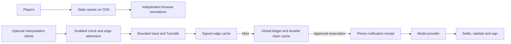

# Traffic and capacity

RumorTown delivers a static application through a CDN. Each browser runs its own village, local agent, replay and research tools. Walking, conversations, typed rumors and exports make no server requests. Share state travels in the URL fragment. This release has no accounts, shared live villages or server-side saves.

This removes central simulation work as the audience grows. It does **not** establish a measured capacity of one million concurrent players. Delivery, first-load traffic, device performance and optional API traffic need separate measurements.



## Static delivery

The game has no Worker script, SSR, `run_worker_first`, database or model gateway in its delivery path. Hashed `/assets/*` files have a one-year immutable browser cache policy. HTML and unversioned files retain revalidation, so releases can point to new hashes. Cloudflare currently lists static asset requests as free and unlimited; Worker invocations have separate billing and quotas. This is platform policy, not a load-test result. See [asset billing](https://developers.cloudflare.com/workers/static-assets/billing-and-limitations/) and [headers](https://developers.cloudflare.com/workers/static-assets/headers/).

The production workflow deploys the optional API only when repository variable `DEPLOY_OPTIONAL_API` is `true`. The API is disabled by default, and the current writing form does not call it. API outages do not interrupt local play.

## Optional API limits

Origin, enabled-state and edge admission checks precede body parsing and upstream work. Anonymous callers share an IP-based quota of 20 requests/minute/location; all callers share 60 requests/minute/location. Shared networks can hit the anonymous quota together. These small limits protect a tiny shared AI allowance, and never apply to gameplay.

Cloudflare rate counters are approximate and local to a network location. They shed load but cannot guarantee a global request or money ceiling. Missing or failed bindings reject requests. See [rate-limit behavior](https://developers.cloudflare.com/workers/runtime-apis/bindings/rate-limit/).

Bodies have a 16 KiB byte limit, including streams with missing or false Content-Length, and a five-second read deadline. Malformed JSON returns 400, slow bodies 408, oversized bodies 413, unsupported formats 415 and throttling 429 with `Retry-After`. Clients should honor delays and avoid automatic inference retries.

After Turnstile, signed edge-cache hits bypass the ledger, model and phone notification. Entries expire after an hour and are separated by claim hash, cast version and signing public key. Hits require signature and taxonomy validation. Only structured claims are cached; browser responses remain `no-store`. Cache failure falls back to the durable cache. Caches are per location, so cold misses can still converge on the ledger. See [Cache API behavior](https://developers.cloudflare.com/workers/runtime-apis/cache/).

One exact ledger coordinates the deliberately small inference budget: five uncached calls/visitor/hour, twenty globally/minute, $0.019/day and $7 lifetime including outstanding holds. Concurrent cold misses can reserve separately for identical text, but every reservation must fit all caps. Do not shard this into independent $7 budgets. It is not a service for millions of simultaneous model calls.

Visitor/minute records are pruned hourly, completed reservation IDs after 30 days, and the durable FIFO claim cache is capped at 2,048 entries. Daily balances, unresolved holds and billing faults remain. Cleanup cannot refund spent money or uncertain charges; retries against removed IDs fail closed. Investigate old holds manually.

The $10 AI allowance does not cover unlimited inference, domains or Worker hosting charges. Rejected API requests still create Worker traffic. Keep the optional API undeployed until needed, confirm account quotas/billing controls, and configure a non-resetting capped provider key separately.

## Planning assumptions

For illustration, assume ten asset requests per cold visit, at most 400 KB compressed assets, and twenty-minute sessions. These are planning inputs, not observed usage.

| Audience | Average new visits/second | Initial asset requests/second |
| --- | ---: | ---: |
| 1 million visits / 30 days | 0.39 | 3.9 |
| 1 million visits / day | 11.57 | 115.7 |
| 1 million simultaneous players, twenty-minute sessions | 833.3 | 8,333.3 |

One million cold visits transfer roughly up to 400 GB under the asset budget. Repeat visits can reuse files. Synchronized launches can greatly exceed averages: a million arrivals at once differs from maintaining a million sessions.

## Verification and rollout

The scale tests cover 1,000 concurrent disabled requests with zero upstream work, 500 warm edge hits without ledger work, 1,000 competing money reservations, bounded bodies and cleanup without budget resets. Native rate-limit bindings are mocked there; tests do not measure Cloudflare's capacity.

Build the game, then start these local servers in separate terminals:

```sh
npx --no-install wrangler dev --local --config apps/rumortown/wrangler.toml --port 8880 --inspector-port 9280
npx --no-install wrangler dev --local --config apps/api/wrangler.toml --port 8879 --inspector-port 9279 --persist-to /tmp/rumortown-load-ledger
```

Run HTTP checks:

```sh
npm run load:check -- --url http://127.0.0.1:8880/ --requests 1000 --concurrency 32
npm run load:check -- --url http://127.0.0.1:8879/interpret --mode api-disabled --requests 1000 --concurrency 32
```

Pass an actual hashed asset URL instead of `/` to check JS delivery. The harness reports statuses, failures, throughput and p50/p95/p99 latency after draining bodies. API mode sends invalid `{}` input, so cannot dispatch a model even if AI is enabled. Runs are bounded to 20,000 requests and 128 concurrent connections. Remote checks require `--allow-remote` and an owned staging target with an agreed request budget.

Before a large launch, deploy staging and ramp distributed traffic against expected arrival rates and geography. Record cold/warm cache hits, failure rates and tail latency. Test disabled AI, admission rejection and upstream outages separately from the static game. Agree service targets and account limits before sustained tests; confirm very large burst expectations with the provider. The local harness is a smoke test, not a million-user generator. Multiplayer, accounts or server agent jobs need a further capacity design.
